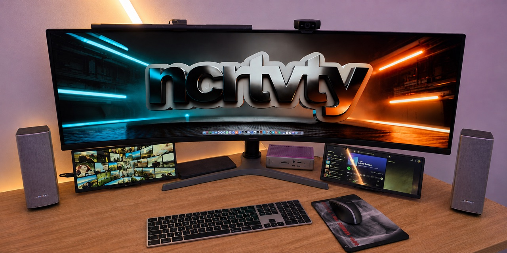

# WorkSpace

### Your projects, applications, terminals, and system status—one tap away.


WorkSpace turns a dedicated macOS touch display into a configurable command
centre for your work. Group folders into visual workspaces, open each project
in the right applications or terminal, monitor your Mac, and switch context
without rearranging the windows on your primary display.

It also includes the macOS touch-routing driver needed to make the CORSAIR
XENEON EDGE—and compatible WCH-controller displays—behave properly in a
multi-display setup.



> [!NOTE]
> WorkSpace is independent open-source software. It is not affiliated with or
> endorsed by Corsair or WCH.

## Why WorkSpace?

Small secondary displays are great at showing information, but they become far
more useful when they understand how you actually work. WorkSpace makes the
display a destination, not a mirror: every workspace has its own folders,
colour, applications, terminal behaviour, and launch actions.

- **Bring your own workflow.** Create, edit, reorder, and colour any number of
  workspaces and folders.
- **Launch the right context.** Open a folder in Finder, a configured macOS
  application, a terminal, or an application-and-terminal recipe.
- **Use only the apps on your Mac.** WorkSpace assumes no third-party editor is
  installed and exposes only applications you configure and macOS can find.
- **Configure per folder.** Choose visible applications, ordering, defaults,
  and primary tap behaviour independently for every folder.
- **Keep useful information visible.** See live CPU load, memory use, uptime,
  and touch-driver health.
- **Make touch belong to the touched screen.** A touch on the EDGE is routed to
  the EDGE even when the pointer started on another display.
- **Borrow the pointer—or keep it there.** Choose whether the pointer returns
  to its original position after an EDGE interaction.
- **Use natural gestures.** Tap, double-click, pixel-scroll, and hold-to-drag,
  with protection against malformed controller input.
- **Stay local.** Configuration and diagnostics remain on your Mac. WorkSpace
  has no account, cloud service, or telemetry.

## What is in the repository?

| Component | Responsibility |
| --- | --- |
| [`dashboard-app`](dashboard-app) | Native AppKit/SwiftUI application, touch-first dashboard, Preferences, application launching, terminal integration, and system metrics |
| [`touch-driver`](touch-driver) | Independent user-space HID driver, display pairing, coordinate mapping, gesture synthesis, focus restoration, and input-storm containment |
| [`docs`](docs) | Architecture, permissions, touch setup, and implementation boundaries |
| [`Scripts/test-all.sh`](Scripts/test-all.sh) | One command that runs both Swift test suites |

The dashboard and driver are separate processes by design. The driver owns the
privileged input-routing work; the dashboard can read its health but never gets
arbitrary HID access.

```text
touch hardware
      │
      ▼
touch-driver ── maps touch to the correct display
      │
      ▼
WorkSpace dashboard ── launches trusted apps and terminal actions
```

Read the deeper design notes in [Architecture](docs/ARCHITECTURE.md).

## Requirements

- macOS 13 Ventura or newer
- Full Xcode installation for source builds
- CORSAIR XENEON EDGE, or a compatible display exposing the
  `wch.cn TouchScreen` controller as USB `27C0:0859`
- Accessibility and Input Monitoring permission for the touch driver
- Automation permission when WorkSpace controls a terminal application

The reference dashboard targets the XENEON EDGE's 2560×720 display. The driver
also supports multiple compatible displays and includes physically verified
support for selected rebranded WCH-controller panels. See the
[driver compatibility table](touch-driver/README.md#known-compatibility) for
the current evidence.

## Install from source

WorkSpace is currently distributed as source while signing, notarisation, and
the release/update path are being prepared.

### 1. Install the touch driver

From the repository root:

```sh
./touch-driver/Scripts/install.sh
```

The installer runs without `sudo`, installs only for the current user, and
registers a LaunchAgent. macOS will require you to approve **Input Monitoring**
and **Accessibility** for the installed driver. If more than one compatible
screen is attached, follow the on-screen **Touch and release the circle** flow.

See [Touch setup and permissions](docs/TOUCH_SETUP.md) for the complete guided
process.

### 2. Install the dashboard

```sh
./dashboard-app/Scripts/install-app.sh
```

This builds, installs, and launches the current development app in
`~/Applications`. Open Preferences to choose the EDGE display, create your
workspaces, add folders, manage available applications, and configure terminal
behaviour.

> [!IMPORTANT]
> Development builds use ad-hoc signing unless `CODESIGN_IDENTITY` is supplied.
> Rebuilding an ad-hoc-signed input driver can cause macOS to request privacy
> approval again. Use a consistent signing identity for regular development.

## Using WorkSpace

1. Create a **Workspace** for a client, role, product, or mode of work.
2. Add one or more **Folders**. The same folder can belong to multiple
   workspaces.
3. Add the macOS applications you want WorkSpace to offer.
4. Configure each folder's visible apps, ordering, default app, and primary tap
   action.
5. Tap a folder to choose an action—or configure it to launch its default
   recipe immediately.

Folder actions operate on the exact folder you selected. The web dashboard can
only request typed actions allowlisted in native Swift; it cannot execute
arbitrary shell commands.

Current terminal adapters support:

- iTerm2, including configured tab and pane layouts
- macOS Terminal, using reliable window-based launches

## Privacy and safety

- No `sudo` installation
- No account, analytics, or remote service
- User configuration stored locally under `~/Library/Application Support`
- Portable exports omit display identifiers, absolute application paths, and
  security-scoped bookmarks
- Native actions restricted to validated folder URLs and configured macOS
  application bundle identifiers
- Touch validation and per-controller storm isolation to reduce unintended
  pointer movement and clicks from faulty input

The existing dashboard installation identity and preference path are retained
for upgrade continuity while the public name transitions to WorkSpace. This
avoids discarding preferences or needlessly invalidating macOS permissions.

## Build and test

Run the complete test suite from the repository root:

```sh
./Scripts/test-all.sh
```

Run either package independently:

```sh
swift test --package-path dashboard-app
swift test --package-path touch-driver
```

The current suite contains **177 tests** covering dashboard preferences,
portable configuration, display selection, application and terminal behaviour,
touch mapping, gestures, pairing authority, hotplug recovery, and malformed
input containment.

## Project status

WorkSpace is under active, hardware-driven development. The core dashboard and
driver are working, but the project is not yet a signed, notarised, one-click
release.

Before the first public binary release, the project still needs:

- final application and bundle-identity migration;
- Developer ID signing and hardened-runtime validation;
- notarisation;
- packaged installation and updates;
- broader hardware verification beyond the currently tested displays.

Issues and compatibility reports will be welcome once the new public repository
is online. Reports from both working and non-working WCH-controller displays
help establish the real compatibility boundary.

## License

The touch driver retains its existing MIT license and attribution in
[`touch-driver/LICENSE`](touch-driver/LICENSE). A repository-wide license for
the dashboard and combined distribution must be selected before the first
public release.

## Acknowledgements

WorkSpace builds on public macOS touchscreen research and the projects credited
in [`touch-driver/THIRD_PARTY_NOTICES.md`](touch-driver/THIRD_PARTY_NOTICES.md).
The driver history has been preserved in this monorepo rather than flattened,
so its original development and attribution remain visible.
